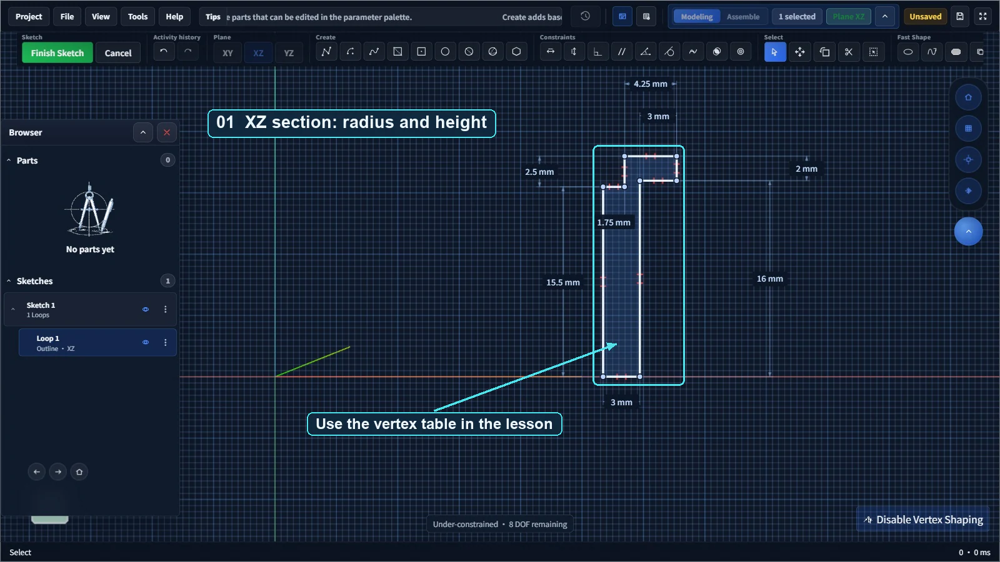
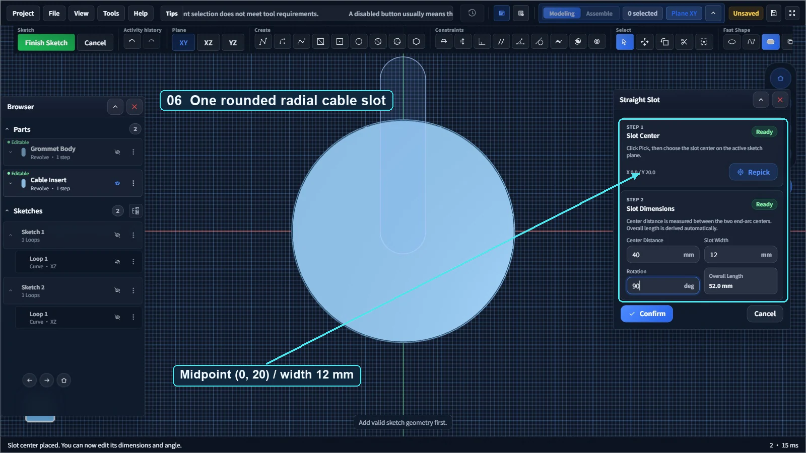
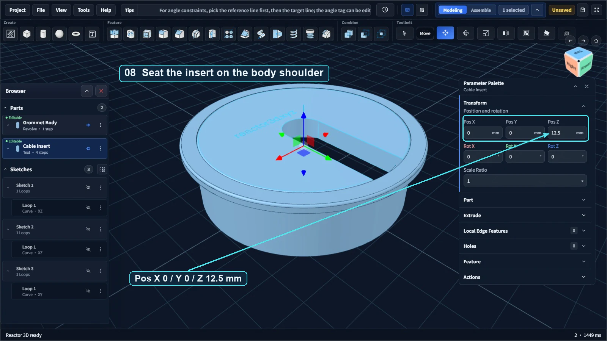

# Desk Cable Grommet Fit Practice

A removable cable grommet has three different fits to verify. This example is a two-part design for a nominal 60 mm desk opening, with a flanged sleeve and a stepped insert you can lift out to route the cable. This repository provides the two original STL parts and three CAD screenshots.

_AI disclosure: An AI assistant prepared this case study from the Reactor 3D Team’s original tutorial and CAD screenshots._

## Download the parts

- [cable-insert.stl](cable-insert.stl)
- [grommet-body.stl](grommet-body.stl)

## Separate the three fits

A desk opening, the insert cap and the lower guide need their own dimensions. Measure the actual desk opening before using the nominal Ø60 mm value. The sleeve’s Ø59.5 mm barrel leaves 0.25 mm radial room at that nominal opening. The Ø65.5 mm, 2 mm thick flange sets the top stop. Keep that flange dimension independent if you adjust the barrel.

The Ø56.6 mm cap fits into a Ø57 mm seat, giving 0.20 mm radial clearance. The Ø53 mm guide fits inside the Ø53.5 mm bore, giving 0.25 mm radial clearance. In each case, subtract the smaller diameter from the larger one and divide by two. This is why changing the entire model by one scale factor is a poor way to tune one fit.

## Check the cable path and the flush surface

The 12 mm slot opens at the edge of the removable insert. In the CAD preview, its round inner end is centered and the far end extends past the rim. The opening lets you place a cable sideways while the insert is out. Measure the cable jacket and the largest connector you need to feed through the open sleeve before committing to these dimensions.

In a section view, check that the cap shoulder meets the seat at Z15.5 mm and that the cap top meets the body at Z18 mm. The published insert sits at Z12.5 mm, with no rotation. Check the outer flange rounding separately; the mating seat remains square.

## Print a seat test before the full pair

Import the files as millimeters. Put the sleeve and insert on the bed separately, because the insert STL retains its assembled height. Preview each first layer and the surfaces beneath the flange and cap. Use the slicer preview to decide whether your chosen orientation needs supports.

Print a short matching seat and insert sample using the intended material and slicer settings. Check that the cap sits flush and lifts out without binding, then adjust the affected diameter alone if needed. The source gives nominal CAD dimensions; it does not report a physical print test.

[Read the original desk cable grommet tutorial](https://reactor3d.xyz/en/tutorials/3d-printed-desk-grommet) by the Reactor 3D Team.

[Visit the Reactor 3D homepage](https://reactor3d.xyz/) for more CAD exercises.
